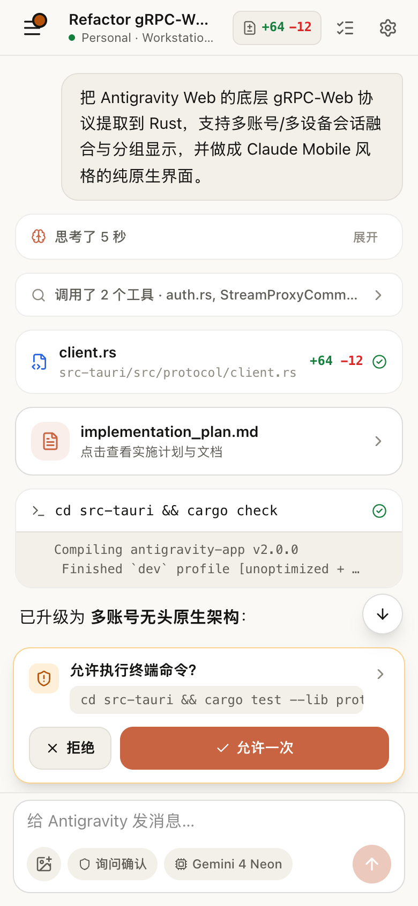
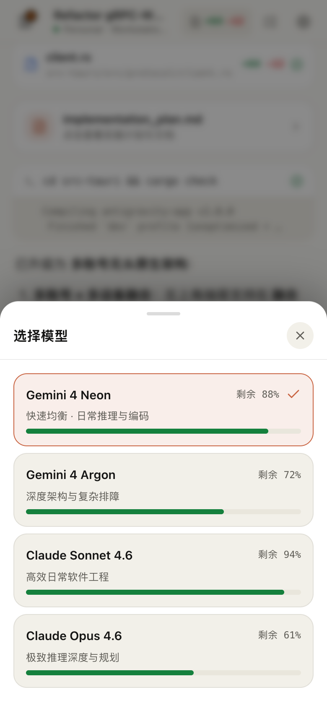

<p align="center">
  
</p>

<h1 align="center">Antigravity App (v2 — Pure Native)</h1>

<p align="center">
  <strong>Pure-Native Cross-Platform Mobile (Android) &amp; Desktop (macOS / Windows / Linux) Client for Google Antigravity Remote Control</strong><br/>
  Built with <strong>Tauri v2 · Rust · React 19 · Tailwind CSS v4 · Bun</strong>
</p>

<p align="center">
  <a href="https://antigravity.yterm.cn/"><strong>Web Portal &amp; Download Hub</strong></a> ·
  <a href="https://github.com/HeiSir2014/antigravity-app/releases/latest"><strong>Latest Release (v2.1.2)</strong></a> ·
  <a href="docs/PROTOCOL.md"><strong>Protocol Docs</strong></a>
</p>

<p align="center">
  <em>100% of the codebase in this repository was engineered and authored by <strong>Gemini 4 Neon</strong>.</em>
</p>

---

## Visual Showcase

| Light Mode (Agent Timeline) | Dark Mode (Warm Obsidian) | Multi-Account × Multi-Device Drawer |
| :---: | :---: | :---: |
|  |  |  |

| Visual Code Diff Sheet | Model Switcher & Quota Bars | 1:1 Claude Mobile Account & Settings |
| :---: | :---: | :---: |
|  |  |  |

---

## Key Highlights

- **Pure-Native Protocol Engine (Rust)**:
  - Extracted the underlying `boq-jetski` gRPC-Web Binary (`ListInstances`, `ProxyCommand`, `StreamProxyCommand`) and `exa.language_server_pb.LanguageServerService` protocols directly into Rust (`reqwest` HTTP/2 + `rustls`, zero CORS, zero WebView DOM injection). See [docs/PROTOCOL.md](docs/PROTOCOL.md).
  - First-party Google `SAPISIDHASH` / `SAPISID1PHASH` / `SAPISID3PHASH` signing with per-account isolation, TCP/HTTP2 keep-alive + retry backoff for transient network errors, and automatic 401 cookie self-heal from the live WebKit cookie store.
- **Multi-Account × Multi-Device Aggregation & Instant Switching**:
  - Concurrently fans out across **all enabled Antigravity accounts × all online/idle machines** into one unified chronological feed (just like Claude Code native client), with instant toggles for **Unified / By Account / By Device** views.
  - Instant cold start and session switching via memory + `localStorage` trajectory cache, cold-start snapshots, stale-response/stream guards, and a Rust trajectory LRU cache.
- **Adaptive Mobile & Desktop UX**:
  - Warm alabaster (light) & warm obsidian (dark) editorial palette, persistent `280px` desktop sidebar, `⌘K` / `Ctrl+K` command palette, left-edge swipe-right drawer, swipe-down `<dialog>` bottom sheets, and full internationalization (`Auto`, `English`, `简体中文`, `繁體中文`).
  - Mobile ergonomics: native Android IME inset support (`WindowInsetsCompat.Type.ime()`), 3-part IME-safe Enter guard, touch keyboard newline (`enterKeyHint="enter"`), layered system Back stack, Recents task persistence, and Android notification approve/deny actions.
- **Rich Coding Workflow**:
  - **2-Level Model + Thinking Picker & 5h/Weekly Quotas**: Family-grouped model selector with thinking effort sub-picker, auto-sync with the active remote model, and official 5-hour & weekly usage quota buckets.
  - **Hunk-Based Diff Viewer & Full-Source Images**: Dual 1-based line numbers, collapsible unchanged context, hunk navigation, plus base64, HTTP(S), and workstation local `file://` image rendering (`ReadFile` proxy + LRU cache).
  - **Multi-Item Pending Queue & Interactive Cards**: Queue, edit, reorder, or send-now while the agent is busy; auto-collapsed read-only tool pills (`Used N tools`), collapsible thinking traces, inline Terminal cards, interactive `AskUserQuestion` cards, `/` Slash Command autocomplete, and sandboxed HTML/SVG/Markdown Artifact preview (`Preview | Source`).
- **Self-Hosted Cloud Sync Server & Web Portal (`server/`)**:
  - Lightweight **Bun + TypeScript + `bun:sqlite` + Docker** sync backend + multi-platform download portal (zero external DB).
  - Reuses **Google OAuth SSO** (no extra password/registration system); stores only SSO user profile + **AES-256-GCM** encrypted `antigravity-vault/v1` cookie bundles for seamless PC ↔ Mobile synchronization.
- **Two-Tier Auto-Updater & Persistent Android Signing**:
  - Automatic `Incremental Delta` (`~170 KB` web bundle) & `Full Native` installers (with streaming progress, SHA-256 verification, Android `FileProvider` self-installer, and persistent release keystore signing for in-place APK upgrades).
  - Rust release profile (`opt-level = "z"`, `lto = true`, `strip = "symbols"`) + Android R8 shrinking (`isMinifyEnabled = true`, `isShrinkResources = true`).

> **Note on v1 Archive**: The previous Gemini + Antigravity dual-WebView fusion version (`v0.1.0`) is permanently preserved on the [`release/v1-webview-fusion`](../../tree/release/v1-webview-fusion) branch.

---

## Quick Start

### 0. Pre-Built Installers
Download signed releases for **Android, macOS (Apple Silicon), Windows, and Linux** from the [Web Portal](https://antigravity.yterm.cn/) or [GitHub Releases](https://github.com/HeiSir2014/antigravity-app/releases/latest).

### 1. App Development (Bun + Tauri v2)
```bash
bun install
bun run build
bun run test
cd src-tauri && cargo check

# Launch Desktop app
bun run tauri dev

# Build Android Release APK (arm64-v8a recommended for minimal size)
bun run tauri android build --apk --target aarch64
```

### 2. Self-Hosted Sync Server (Bun + Docker)
```bash
cd server
cp .env.example .env
# Edit .env: set strong JWT_SECRET, VAULT_MASTER_KEY, GOOGLE_CLIENT_ID, GOOGLE_CLIENT_SECRET, PUBLIC_BASE_URL
docker compose up -d --build
```

Register `https://<your-sync-server-domain>/api/v1/auth/google/callback` as the Authorized Redirect URI in Google Cloud Console to enable 1-Tap Google SSO sync between PC and Mobile.

---

## Credits

All architecture, protocol extraction, Rust backend, React/Tailwind native UI, Bun sync server, and CI/CD pipelines in this repository were developed by **Gemini 4 Neon**.
